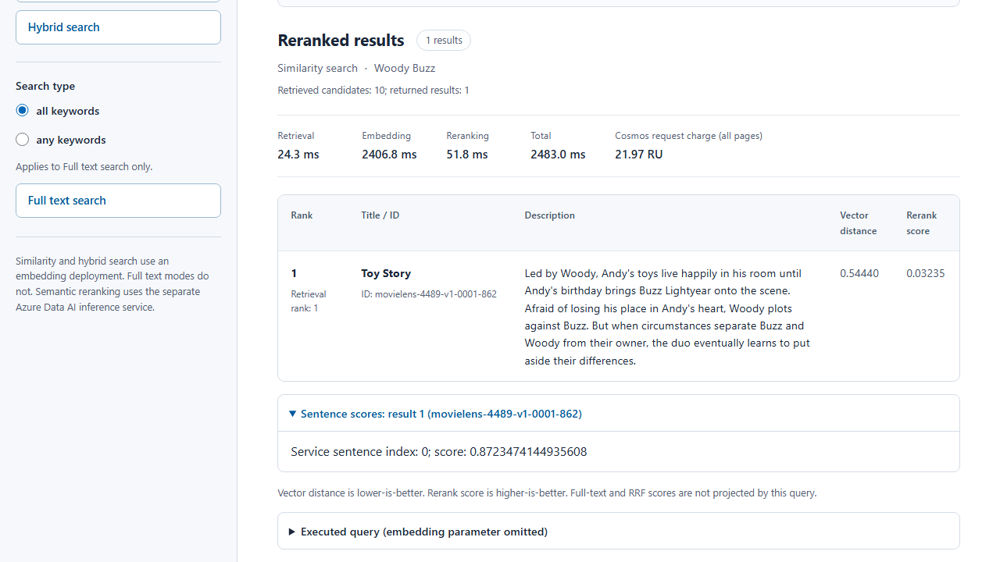

# Azure Cosmos DB semantic search samples

Run Python Streamlit and .NET Razor locally against Azure Cosmos DB for NoSQL,
with real Azure OpenAI embeddings and optional standalone semantic reranking.
Default `azd up` restores the original **MovieLens 4,489-source-row corpus**.
The small original-text fixture is retained only for smoke/offline tests.

## Sample screenshots

These screenshots show the .NET Razor app with MovieLens data, captured during
successful live validation on October 30, 2026. The Python Streamlit app offers
the same search and reranking controls. Results, scores and timings vary by run.

### Search interface

Choose an index and search mode, enter a query, and optionally enable semantic
reranking. This example shows hybrid search for **Woody Buzz** with reranking on.


### Reranked results and sentence scores

This separate similarity-search example uses JSON targeting of the title,
a rerank result limit of **1**, and sentence-score diagnostics. The result
includes its original retrieval rank, vector distance, rerank score and
expandable sentence scores.



See [advanced reranking controls](#advanced-reranking-controls) to try these options.

## Prerequisites

- Git, Azure CLI, Azure Developer CLI (azd baseline 1.25.6), PowerShell 7
  on Windows/macOS/Linux, Python 3.10+ with venv/pip, and .NET 10 SDK.
  On Linux/macOS the bootstrap uses `python3`; on Windows it uses `python`.
- Public PyPI/NuGet and Azure network access with trusted TLS.
  No Docker or hosted application compute is needed.
- Sign into **both** `az login` and `azd auth login` as the same Entra user.
  Select the same tenant/subscription. Tool installation and sign-in are not automated.
- Permissions to create resources and assign scoped roles. Register
  `Microsoft.DocumentDB`, `Microsoft.InferenceService`, and
  `Microsoft.CognitiveServices`. Confirm inference preview access and Cosmos quota.
- Available Azure OpenAI quota for `text-embedding-3-small`, version `1`,
  **GlobalStandard**, capacity `30`, in **UKSouth**. Availability varies by
  subscription. This is pay-per-token capacity, not provisioned throughput.
  GlobalStandard may process requests globally, not only in UKSouth.
- Accept ongoing charges: four containers at **400 RU/s each**, storage,
  inference usage and embedding tokens. Failed deployments may leave paid
  resources. Nothing automatically deletes resources.

See [all prerequisites and recovery](python/infra/azd/README.md) for details.

## Deploy and start

From the cloned repository root:

```powershell
azd up
pwsh ./scripts/start.ps1
```

Choose a fresh, unique environment name and the intended subscription when azd
prompts. Default Cosmos/inference region is UKSouth. Use only lowercase letters,
digits and hyphens in the environment name. Preserve ignored `.azure/` state.
No prior `azd init` or `azd env new` is required. For explicit selection, pass
`--environment <name> --subscription <id> --location uksouth` directly to `azd up`.

The launcher automatically loads generated root config and stays in the foreground:

- Streamlit: <http://127.0.0.1:8501>
- Razor: <http://127.0.0.1:8503>

Ctrl+C stops only the launcher's owned processes. Busy ports cause an error,
not a process kill. A child exit stops its sibling and fails the launcher.
Use `-PythonPort` and `-DotnetPort` to select other ports. Startup never seeds data.

Try **Woody Buzz**, **fishing buddies**, or **toys learning to share a child's affection**.
For both indexes, try vector, full-text all/any, full-text ranking and hybrid,
with reranking off and on. Optional JSON targeting, result limits and sentence
diagnostics are in the collapsed **Advanced reranking** section.
For manual startup and code walkthroughs, see the
[Python search guide](python/SEARCH_GUIDE.md) or [.NET search guide](dotnet/SEARCH_GUIDE.md).

## Advanced reranking controls

In either app, enable **Semantic Reranker**, expand **Advanced reranking**,
choose the options below, then run a search. When reranking is off, these
controls are disabled and their saved values have no effect.

| Control | What selecting it does |
| --- | --- |
| **Document format: text** (default) | Sends each candidate's description as plain text for reranking. The title is not included, and JSON field selection has no effect. |
| **Document format: json** | Sends each candidate as a JSON object containing only the selected fields, so the reranker can use the title, description, or both. |
| **JSON fields** (JSON mode only) | **Title** targets `title`; **Description** targets `text`; **Title and Description** (default) targets both. Unselected fields, embeddings, IDs and Cosmos system properties are not sent to the reranker. |
| **Rerank result limit** (default **10**, range **1-10**) | Sets reranker `topK`: how many of the retrieved candidates to return, ordered by reranking score. It does not change the Cosmos query's candidate limit, which remains 10. If only two candidates were retrieved, a limit of five still returns only two. |
| **Sentence-score diagnostics** (default **off**) | Requests optional sentence-level scores. Expand the sentence-score details for a returned result to see the service's sentence indices and scores. If the service provides none, the app displays **not returned**. |

These options affect reranking only, not which documents Cosmos retrieves or
how query embeddings are generated. A smaller result limit does not reduce the
number of candidates sent for scoring. Sentence indices are service-defined;
the apps do not map them to JSON fields or highlight matching source sentences.

**Try it:** search for **Woody Buzz**, select **json**, choose **Title and
Description**, set the result limit to **3**, and enable sentence-score
diagnostics. Run the search, then compare with **Title** alone. The selected
fields can change relevance scores and ordering, but a different order is not
guaranteed. No app restart or redeployment is needed.

For request payloads, validation and result mapping, see the
[Python advanced-reranking walkthrough](python/SEARCH_GUIDE.md#advanced-json-targeting-top-k-and-diagnostics)
or [.NET advanced-reranking walkthrough](dotnet/SEARCH_GUIDE.md#advanced-reranking).

## What azd up does

1. `preup` bootstraps dependencies and persists/reuses the account GUID.
   It resets inference creation to `false` without authentication or Azure calls.
   The service-free workflow then runs only native `azd provision`, not
   package/deploy steps. Mandatory `preprovision` uses azd's resolved
   subscription/location for the authenticated inference GET. Only HTTP 404
   authorizes creation. No early hook guesses CLI flags or uses the CLI's
   default subscription. Existing venv and incremental .NET outputs are reused.
2. Bicep provisions keyless Cosmos/inference and Azure OpenAI backends with
   scoped user roles. `postprovision` writes only private local configuration:
   `python/.env`, `python/.local/azd-env.ps1`, and `.local/azd-env.ps1`.
3. `postup` downloads the pinned MovieLens file into an ignored local cache,
   validates its raw bytes, checksum, schema and all 4,489 rows, then batches
   real embeddings of `overview` from the deployed model. It validates every
   vector and target policy, checks ownership across every target before writes,
   and verifies every expected record by full readback. All search modes use
   this same embedding deployment.

`azd provision` refreshes infrastructure/config **without seeding**. Only
`azd up` runs the seed hook automatically. Repeating `azd up` keeps account names
and stable record IDs, reuses valid cached embeddings, and skips unchanged
validated records. Missing owned records can be repaired. It never deletes unrelated
documents. An occupied seed ID with foreign or changed source content fails closed.
Provenance records model, version, deployment, dimensions and source-text hash.
The loader retries explicit role-propagation 403 and transient 429/5xx responses within bounds.
Fix the cause and repeat `azd up`; a partial seed is safe to resume.

No keys, fake-vector fallback, hosted services, manual loader commands or
endpoint copying are required for this default path.

## MovieLens source and migration boundary

The source is the original repository's [MovieLens file pinned in the user's fork](https://github.com/TheovanKraay/AzureDataRetrievalAugmentedGenerationSamples/blob/7fd162fc633617857f8b8ed2c5b2b92d4d8ef0b6/DataSet/Movies/MovieLens-4489-256D.json).
Raw download: **48,244,182 bytes**, SHA256
`5f43a3b0815b80b85c647b38d3d86c320aaf0c0937a79561fe643156e62c6295`.
No corpus is vendored. A CRLF-converted checkout is not the pinned raw file.
The source repository retains its Microsoft MIT attribution.

There are 4,489 rows but 4,486 distinct original movie IDs. All rows survive:
`movielens-4489-v1-<one-based padded row index>-<source movie ID>` is the document
ID, and `source_movie_id` retains the original ID. `source_metadata` preserves
the source fields except the discarded 256-dimensional `vector`.
`overview` maps to `text`; title remains `title`. Source row hashes and embedding
deployment/model/version/dimensions/text hashes are stored separately.
Real embeddings request 1536 dimensions. Only title/text can reach the reranker.

After **all target containers** pass exact full-source readback, the hook's
explicit `--cleanup-original-fixtures` flag removes only the exact ten unchanged
`original-movies-v1-` fixture IDs per target, with matching data/provenance/ownership
and conditional etags. Changed or foreign fixture records cause an explicit
error, not deletion. No prefix deletion, unrelated cleanup or startup writes.
The source-corpus label in the UI is not an authoritative live container count.
Retrieval still selects at most **10 candidates**, unrelated to corpus size.

Embeddings and per-run receipts live in `python/.local/movielens/`.
**The first full load can take time.** It downloads the corpus, generates real
embeddings, writes every target, and verifies the full dataset. Duration depends
on service latency, throttling and role propagation; no fixed completion time is
promised. Watch embedding-batch progress and each container's preflight, write
and readback progress. Provisioning success alone does not mean the corpus is ready:
wait for the seed hook to succeed before treating the load as complete.

Completed batches survive failure; rerunning skips embedding calls for validated
cache entries and writes for unchanged records, but always repeats full readback.
Keep the ignored cache when resuming. Each invocation creates a separate
`receipt-<unique-id>.json`, preserving earlier run receipts. Inspect its status,
source rows, per-container verified/skipped/written counts, reused embeddings,
removed fixtures, page counts and phase timings. Keep these receipts private.
Cache corruption fails explicitly; remove only the named bad entry to regenerate.
A model/deployment/version change selects new cache entries and conditionally
replaces sample-owned embeddings. Do not mix models with unrelated data.

To resume only the data step against already configured resources (no provisioning):

```powershell
. ./.local/azd-env.ps1
& ./python/.venv/Scripts/python.exe python/src/seed_movies.py `
  --include-dotnet --confirm-write --cleanup-original-fixtures
```

On non-Windows use `./python/.venv/bin/python`. `--batch-size` defaults to 32,
bounded to 1-64. `--source-file <path>` is optional but enforces the same exact
production bytes/hash/schema/count. Arbitrary CLI runs still require
`--confirm-write`; cleanup is a separate explicit authorization.

## Configuration and advanced workflows

Before provisioning, use `azd env set <variable> <value>`:

| Variable | Default |
| --- | --- |
| `AZURE_OPENAI_LOCATION` | `uksouth` |
| `EMBEDDING_MODEL` | `text-embedding-3-small` |
| `EMBEDDING_VERSION` | `1` |
| `EMBEDDING_DEPLOYMENT` | `text-embedding-3-small` |
| `EMBEDDING_SKU` | `GlobalStandard` |
| `EMBEDDING_CAPACITY` | `30` |

`text-embedding-3-large` is also supported with explicitly requested 1536 dimensions.
Choose a supported model/version/region/SKU combination and available quota.
Standard and DataZoneStandard are configurable where supported; their processing
boundaries differ from GlobalStandard. ARM errors for unavailable models or quota
are fatal. No automatic region change or throughput purchase occurs.
Changing the model requires rerunning `azd up` to re-embed sample records.
Do not mix embedding models in an existing dataset.

- [Standalone Python](python/README.md)
- [Existing-resource and manual integration workflows](README.manual.md)
- [.NET details and browser checks](dotnet/README.md)
- [Configuration switching and resource contract](infra/azd/README.md)

Stop apps before switching environments. Run `azd env select <name>`,
`azd env refresh`, `pwsh ./scripts/postprovision.ps1`, then restart the launcher.
Never commit generated configuration. Do not run `azd down` as a test.

## Verification

After `azd up`, in PowerShell:

```powershell
. ./.local/azd-env.ps1
$py = if ($IsWindows) { './python/.venv/Scripts/python.exe' } else { './python/.venv/bin/python' }
& $py -m pytest -q python/tests/unit python/tests/ui
dotnet test dotnet/SemanticReranker.sln --no-build --filter 'Category!=Live'
$env:RUN_LIVE_TESTS = '1'
& $py -m pytest -q python/tests/live/test_original_movies.py
dotnet test dotnet/SemanticReranker.sln --no-build --filter 'FullyQualifiedName~OriginalMovieLiveTests'
Remove-Item Env:RUN_LIVE_TESTS
```

These live suites do not inject synthetic query vectors. They cover both indexes,
all modes and rerank toggles, plus a modest Toy Story top-three assertion for ranked
results. Allow index propagation, then investigate failures rather than disabling
modes. Repeat `azd up` and these checks to verify idempotency. Older synthetic
integration suites remain available through the manual workflow, under separate IDs.

For real browser verification, keep the launcher running in one terminal. In
another terminal with generated config loaded:

```powershell
& $py -m pip install -r python/requirements-browser.txt
& $py -m playwright install chromium
$env:RUN_LIVE_TESTS = '1'
& $py python/scripts/verify_browser.py --include-dotnet
Remove-Item Env:RUN_LIVE_TESTS
```

This visits both already-running apps, exercises the full mode/toggle matrix,
prints each successful case and saves screenshots only under
`python/.local/validation/movielens/`. It neither starts nor stops apps.
Browser tooling is optional and is not installed during `azd up`.
Add `--matrix advanced` for an advanced-only rerun, or `--matrix baseline`
for only the original cases. The default runs both.
