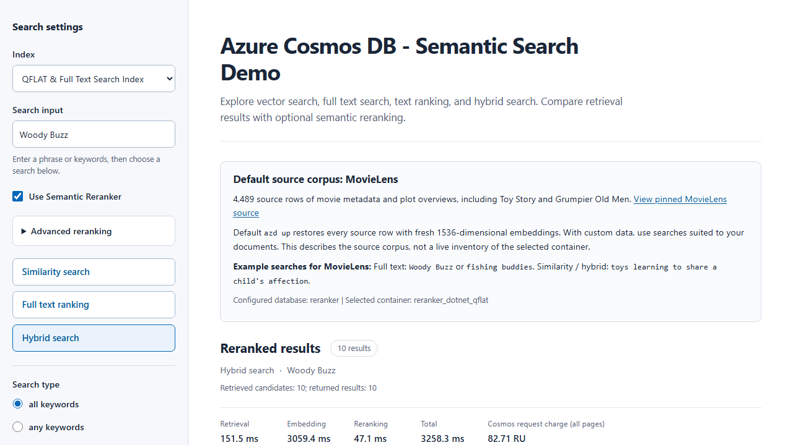

# Azure Cosmos DB semantic search samples

Run Python Streamlit and .NET Razor locally against Azure Cosmos DB for NoSQL,
with real Azure OpenAI embeddings and optional standalone semantic reranking.
The default deployment loads **4,489 MovieLens records** so you can explore
vector, full-text, and hybrid search with the same dataset in both apps.

## Sample screenshots

The .NET Razor app is shown below. The Python Streamlit app offers the same
search and reranking controls. Results, scores, and timings vary by query and run.

### Search interface

Choose an index and search mode, enter a query, and optionally enable semantic
reranking. This example shows hybrid search for **Woody Buzz** with reranking on.



### Reranked results and sentence scores

This example reranks vector-search results using the title field, a result
limit of **1**, and sentence scores. The result
includes its original retrieval rank, vector distance, rerank score and
expandable sentence scores.


See [advanced reranking controls](#advanced-reranking-controls) to try these options.

## Prerequisites

- Git, Azure CLI, Azure Developer CLI (tested with version 1.25.6), PowerShell 7
  on Windows/macOS/Linux, Python 3.10+ with venv/pip, and .NET 10 SDK.
  On Linux/macOS the bootstrap uses `python3`; on Windows it uses `python`.
- Public PyPI/NuGet and Azure network access with trusted TLS.
  No Docker or hosted application compute is needed.
- Sign into **both** `az login` and `azd auth login` as the same Entra user.
  Select the same tenant/subscription. Tool installation and sign-in are not automated.
- Permissions to create resources and assign scoped roles. Register
  `Microsoft.DocumentDB`, `Microsoft.InferenceService`, and
  `Microsoft.CognitiveServices`. Confirm inference availability and Cosmos quota.
- Available Azure OpenAI quota for `text-embedding-3-small`, version `1`,
  **GlobalStandard**, capacity `30`, in **UKSouth**. Availability varies by
  subscription. This is pay-per-token capacity, not provisioned throughput.
  GlobalStandard may process requests globally, not only in UKSouth.
- Accept ongoing charges: four containers at **400 RU/s each**, storage,
  inference usage and embedding tokens. Failed deployments may leave paid
  resources. Nothing automatically deletes resources.

See [all prerequisites and recovery](python/infra/azd/README.md) for details.

## Deploy and start

From the cloned repository root:

```powershell
azd up
pwsh ./scripts/start.ps1
```

Choose a fresh, unique environment name and the intended subscription when azd
prompts. Default Cosmos/inference region is UKSouth. Use only lowercase letters,
digits and hyphens in the environment name. Preserve ignored `.azure/` state.
No prior `azd init` or `azd env new` is required. For explicit selection, pass
`--environment <name> --subscription <id> --location uksouth` directly to `azd up`.

The launcher automatically loads generated root config and stays in the foreground:

- Streamlit: <http://127.0.0.1:8501>
- Razor: <http://127.0.0.1:8503>

Press Ctrl+C to stop both apps. The launcher leaves other processes running
and reports an error if either port is in use. Use `-PythonPort` and
`-DotnetPort` to select other ports. If either app exits, the launcher stops
the other app. Starting the apps does not reload data.

Try **Woody Buzz**, **fishing buddies**, or **toys learning to share a child's affection**.
For both indexes, try vector, full-text all/any, full-text ranking and hybrid,
with reranking off and on. Optional JSON targeting, result limits and sentence
diagnostics are in the collapsed **Advanced reranking** section.
For manual startup and code walkthroughs, see the
[Python search guide](python/SEARCH_GUIDE.md) or [.NET search guide](dotnet/SEARCH_GUIDE.md).

## Advanced reranking controls

In either app, enable **Semantic Reranker**, expand **Advanced reranking**,
choose the options below, then run a search. When reranking is off, these
controls are disabled and their saved values have no effect.

| Control | What selecting it does |
| --- | --- |
| **Document format: text** (default) | Sends each candidate's description as plain text for reranking. The title is not included, and JSON field selection has no effect. |
| **Document format: json** | Sends each candidate as a JSON object containing only the selected fields, so the reranker can use the title, description, or both. |
| **JSON fields** (JSON mode only) | **Title** targets `title`; **Description** targets `text`; **Title and Description** (default) targets both. Unselected fields, embeddings, IDs and Cosmos system properties are not sent to the reranker. |
| **Rerank result limit** (default **10**, range **1-10**) | Sets reranker `topK`: how many of the retrieved candidates to return, ordered by reranking score. It does not change the Cosmos query's candidate limit, which remains 10. If only two candidates were retrieved, a limit of five still returns only two. |
| **Sentence-score diagnostics** (default **off**) | Requests optional sentence-level scores. Expand the sentence-score details for a returned result to see the service's sentence indices and scores. If the service provides none, the app displays **not returned**. |

These options affect reranking only, not which documents Cosmos retrieves or
how query embeddings are generated. A smaller result limit does not reduce the
number of candidates sent for scoring. Sentence indices are service-defined;
the apps do not map them to JSON fields or highlight matching source sentences.

**Try it:** search for **Woody Buzz**, select **json**, choose **Title and
Description**, set the result limit to **3**, and enable sentence-score
diagnostics. Run the search, then compare with **Title** alone. The selected
fields can change relevance scores and ordering, but a different order is not
guaranteed. No app restart or redeployment is needed.

For request payloads, validation and result mapping, see the
[Python advanced-reranking walkthrough](python/SEARCH_GUIDE.md#advanced-json-targeting-top-k-and-diagnostics)
or [.NET advanced-reranking walkthrough](dotnet/SEARCH_GUIDE.md#advanced-reranking).

## What azd up does

1. Installs dependencies and saves generated account names for the environment.
   Before provisioning, it checks for an existing inference account in the
   selected subscription. It creates an account only if that lookup returns
   HTTP 404; authentication and other lookup errors stop deployment.
2. Provisions Azure Cosmos DB, an inference account, and Azure OpenAI with
   keyless access and scoped user roles. The apps run locally rather than in
   hosted application services. `postprovision` writes local configuration:
   `python/.env`, `python/.local/azd-env.ps1`, and `.local/azd-env.ps1`.
3. Downloads and validates the MovieLens dataset, generates embeddings for each
   movie's overview, and loads the Python and .NET containers. The loader
   checks existing records before writing and reads back the dataset to verify
   the load. Both apps use the same embedding deployment.

`azd provision` refreshes infrastructure/config **without seeding**. Only
`azd up` runs the seed hook automatically. Repeating `azd up` keeps account names
and stable record IDs, reuses valid cached embeddings, and skips unchanged
validated records. It restores missing sample records and stops if a sample ID
is occupied by different content. Unrelated documents are not deleted.
Embedding metadata records the model, version, deployment, dimensions, and
source-text hash. The loader uses bounded retries for role propagation and
transient service errors. If loading fails, resolve the reported error and
repeat `azd up` to resume.

The default workflow configures endpoints and loads data automatically; no
account keys or manual loading steps are required.

<a id="movielens-source-and-migration-boundary"></a>

## Dataset and data loading

The sample downloads a [fixed version of the MovieLens dataset](https://github.com/TheovanKraay/AzureDataRetrievalAugmentedGenerationSamples/blob/7fd162fc633617857f8b8ed2c5b2b92d4d8ef0b6/DataSet/Movies/MovieLens-4489-256D.json).
Raw download: **48,244,182 bytes**, SHA256
`5f43a3b0815b80b85c647b38d3d86c320aaf0c0937a79561fe643156e62c6295`.
The dataset is downloaded during setup rather than included in this repository.
When supplying a local copy, use the raw download without modifying its line
endings. See the source repository for license and attribution details.

The dataset contains 4,489 rows and 4,486 distinct movie IDs. To preserve every row,
`movielens-4489-v1-<one-based padded row index>-<source movie ID>` is the document
ID used by the loader, and `source_movie_id` retains the original movie ID. `source_metadata` preserves
the source fields except the discarded 256-dimensional `vector`.
`overview` maps to `text`; title remains `title`. Source row hashes and embedding
deployment/model/version/dimensions/text hashes are stored separately.
Real embeddings request 1536 dimensions. Only title/text can reach the reranker.

When upgrading an environment created with the earlier ten-record sample,
the default loading workflow removes those unchanged sample records only after
the full MovieLens dataset has been verified in every target container.
Modified records are not deleted; the loader reports an error instead.
Other documents are left untouched.

The dataset label in the UI describes the source dataset, not a live container
count. Each search retrieves at most **10 candidates**, regardless of dataset size.

Embeddings and per-run receipts live in `python/.local/movielens/`.
**The first full load can take time.** It downloads the corpus, generates real
embeddings, writes every target, and verifies the full dataset. Duration depends
on service latency, throttling, and role propagation. Follow the loading progress
in the terminal and wait for `azd up` to finish before starting the apps.

Completed batches survive failure; rerunning skips embedding calls for validated
cache entries and writes for unchanged records, but always repeats full readback.
Keep the ignored cache when resuming. Each invocation creates a separate
`receipt-<unique-id>.json`, preserving earlier run receipts. Inspect its status,
source rows, per-container verified/skipped/written counts, reused embeddings,
removed fixtures, page counts and phase timings. Keep these receipts private.
Cache corruption fails explicitly; remove only the named bad entry to regenerate.
A model/deployment/version change selects new cache entries and conditionally
replaces sample-owned embeddings. Do not mix models with unrelated data.

To resume only the data step against already configured resources (no provisioning):

```powershell
. ./.local/azd-env.ps1
& ./python/.venv/Scripts/python.exe python/src/seed_movies.py `
  --include-dotnet --confirm-write --cleanup-original-fixtures
```

On non-Windows use `./python/.venv/bin/python`. `--batch-size` defaults to 32,
bounded to 1-64. `--source-file <path>` is optional but enforces the same exact
dataset bytes, checksum, schema, and row count. Manual loading requires
`--confirm-write`. The separate `--cleanup-original-fixtures` flag permits
removal of the unchanged records from the earlier ten-record sample.

## Configuration and advanced workflows

Before provisioning, use `azd env set <variable> <value>`:

| Variable | Default |
| --- | --- |
| `AZURE_OPENAI_LOCATION` | `uksouth` |
| `EMBEDDING_MODEL` | `text-embedding-3-small` |
| `EMBEDDING_VERSION` | `1` |
| `EMBEDDING_DEPLOYMENT` | `text-embedding-3-small` |
| `EMBEDDING_SKU` | `GlobalStandard` |
| `EMBEDDING_CAPACITY` | `30` |

`text-embedding-3-large` is also supported with explicitly requested 1536 dimensions.
Choose a supported model/version/region/SKU combination and available quota.
Standard and DataZoneStandard are configurable where supported; their processing
boundaries differ from GlobalStandard. ARM errors for unavailable models or quota
are fatal. No automatic region change or throughput purchase occurs.
Changing the model requires rerunning `azd up` to re-embed sample records.
Do not mix embedding models in an existing dataset.

- [Standalone Python](python/README.md)
- [Existing-resource and manual integration workflows](README.manual.md)
- [.NET setup and tests](dotnet/README.md)
- [Configuration switching and resource contract](infra/azd/README.md)

Stop apps before switching environments. Run `azd env select <name>`,
`azd env refresh`, `pwsh ./scripts/postprovision.ps1`, then restart the launcher.
Never commit generated configuration. Use `azd down` only when you intend to
delete the deployed resources and their data.

<a id="verification"></a>

## Run tests

After `azd up`, in PowerShell:

```powershell
. ./.local/azd-env.ps1
$py = if ($IsWindows) { './python/.venv/Scripts/python.exe' } else { './python/.venv/bin/python' }
& $py -m pytest -q python/tests/unit python/tests/ui
dotnet test dotnet/SemanticReranker.sln --no-build --filter 'Category!=Live'
$env:RUN_LIVE_TESTS = '1'
& $py -m pytest -q python/tests/live/test_original_movies.py
dotnet test dotnet/SemanticReranker.sln --no-build --filter 'FullyQualifiedName~OriginalMovieLiveTests'
Remove-Item Env:RUN_LIVE_TESTS
```

The live tests use the deployed embedding model and cover both indexes, all search
modes, and reranking on and off. They also check that a Toy Story query returns
the expected movie among the top three ranked results. If you have just loaded
data, allow time for indexing before running the tests. See the
[manual workflow](README.manual.md) for additional integration tests.

For browser tests, keep the launcher running in one terminal. In
another terminal with generated config loaded:

```powershell
& $py -m pip install -r python/requirements-browser.txt
& $py -m playwright install chromium
$env:RUN_LIVE_TESTS = '1'
& $py python/scripts/verify_browser.py --include-dotnet
Remove-Item Env:RUN_LIVE_TESTS
```

This visits both already-running apps, exercises the full mode/toggle matrix,
prints each successful case and saves screenshots only under
`python/.local/validation/movielens/`. It neither starts nor stops apps.
Browser tooling is optional and is not installed during `azd up`.
Add `--matrix advanced` to test only the advanced reranking controls, or
`--matrix baseline` to test the standard search controls. The default runs both.
